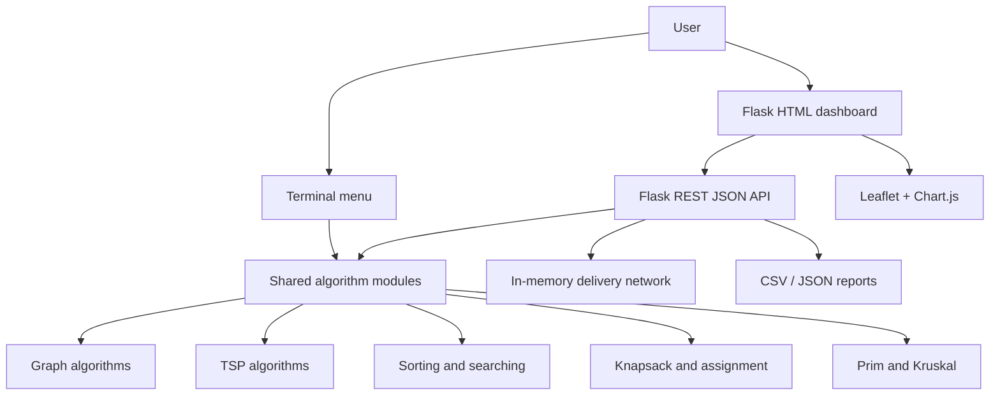

# Project Report: Smart Delivery Route Optimization

## Abstract
Smart Delivery Route Optimization is an Algorithm Performance Laboratory for a modeled city delivery network. It lets a user load or create locations and roads, calculate shortest paths, optimize multi-stop tours, prioritize orders, select packages under vehicle capacity, and plan infrastructure using minimum spanning trees. The system measures runtime, peak traced memory and operation counts so that algorithmic trade-offs can be observed rather than assumed.

## Problem Statement
A delivery operator must connect a warehouse to customer locations and plan efficient tours while considering road distance, traffic, delivery priority and vehicle capacity. Different algorithms provide different guarantees and resource costs. The project provides a controlled environment to compare these approaches on identical input data.

## Objectives
1. Represent a delivery city as a weighted graph.
2. Implement shortest-path and route-optimization algorithms from scratch.
3. Demonstrate sorting, searching, knapsack and MST techniques.
4. Measure execution time, peak memory and operations.
5. Visualize routes and export results for analysis.

## Algorithms and complexity
| Category | Algorithm | Time complexity | Auxiliary space |
|---|---|---:|---:|
| Shortest path | BFS | O(V+E) | O(V+E) |
| Shortest path | Dijkstra (heap) | O((V+E) log V) | O(V+E) |
| Shortest path | A* | O((V+E) log V) typical; exponential worst case | O(V+E) |
| Shortest path | Bellman-Ford | O(VE) | O(V) |
| Shortest path | Floyd–Warshall | O(V³) | O(V²) |
| TSP | Brute force | O((n−1)!) | O(n) |
| TSP | Nearest Neighbour | O(n²) | O(n) |
| TSP | Held–Karp | O(n² 2ⁿ) | O(n 2ⁿ) |
| TSP | 2-Opt | O(n³) per full improvement pass; multiple passes possible | O(n) |
| Sorting | Bubble / Insertion | O(n²) | O(1) / O(n) implementation |
| Sorting | Merge | O(n log n) | O(n) |
| Sorting | Quick | Average O(n log n), worst O(n²) | O(log n) average recursion |
| Sorting | Heap | O(n log n) | O(log n) recursion |
| Searching | Linear / Binary | O(n) / O(log n) | O(1) |
| Loading | 0/1 Knapsack DP | O(nW) | O(nW) |
| Loading | Fractional Greedy | O(n log n) | O(n) |
| Infrastructure | Prim (array frontier) | O(V²+E) | O(V+E) |
| Infrastructure | Kruskal | O(E log E) | O(V) |

## System architecture

## Execution flow
Load or import network → validate node IDs and road weights → convert network to graph/matrix → execute selected algorithm → collect result and performance metrics → store run in in-memory history → visualize/export.

## Results and analysis
The system measures actual execution time and peak Python-traced memory on the current machine. Operation counters are deterministic for a fixed input, while milliseconds and memory can vary with hardware and runtime load. Exact methods (Dijkstra under non-negative weights, Bellman–Ford where negative edges are permitted, Floyd–Warshall, brute force and Held–Karp) provide exact results within their stated constraints. Nearest Neighbour and 2-Opt are heuristics and may return a longer tour. The benchmark endpoint also performs a deterministic size sweep (n = 5, 10, 20, 50, 100) for Nearest Neighbour and 2-Opt and plots measured runtime growth. It computes the gap relative to the best measured feasible candidate in the current-network comparison; it is not a proof of global optimality unless an exact method is included.

## Conclusion
The project demonstrates how graph theory and classical algorithm design support delivery planning. Its interactive and CLI interfaces use the same algorithm modules, making it suitable for demonstrations, testing and repeatable comparison.

## Future scope
Add real geocoding and road-network APIs, time-dependent traffic, delivery time-window feasibility, vehicle routing with multiple depots, persistent database-backed run history, richer benchmark size sweeps, and exact route-gap comparison against Held–Karp for small instances.
